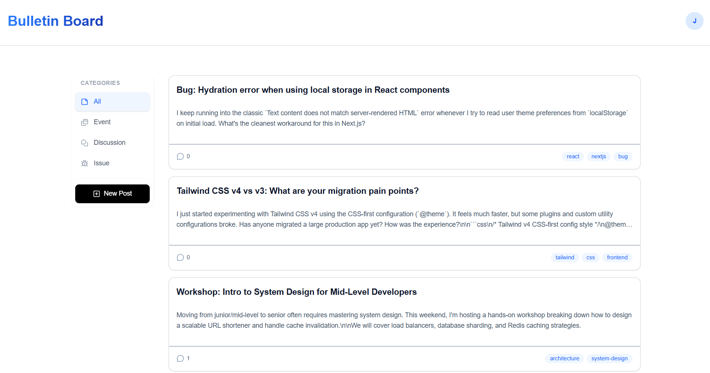

# Bulletin Board App

> A simple and modern bulletin board application.



## 🚀 Features

- **User & Post Management:** Full CRUD operations for users and posts.
- **Interactive Discussions:** Comment system for posts.
- **Authentication:** Secure user authentication powered by [Better Auth](https://better-auth.com) (supports email/password and session management).
- **Modern Tech Stack:** Database management powered by Prisma and Supabase.

## 📋 Prerequisites

Make sure you have the following installed on your machine:
- [Node.js](https://nodejs.org/) (v18 or higher)
- [Git](https://git-scm.com/)

## ⚙️ Installation & Setup

1. **Clone the repository:**
   ```bash
   git clone https://github.com/username/repo-name.git
   ```
   
2. **Install required packages:**
   ```bash
   npm install 
   ```

3. **Run the server:**
   ```bash
   npm run dev
   ```